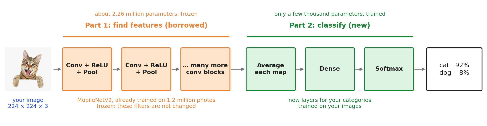

## AI Policy

You may use AI tools. The answers must be about **your** images and **your** results.

## What you will do

Work **individually or in a team of 2**. You will teach a CNN to recognize **2 or 3 categories of images that you choose** (for example cats vs dogs, pizza vs burger vs taco, sedan vs SUV vs truck), using only about 25 images per category.

The trick is **transfer learning**, the two parts from today's slides:

-   **Part 1, find features:** borrowed from MobileNetV2, a CNN already trained on 1.2 million photos. We freeze it: its filters are not changed.
-   **Part 2, classify:** a small new layer for *your* categories. This is the only part we train.

{width=100%}

Then you play **Stump the Model**: find an image that fools your model.

## Steps

1.  Open the notebook: [**transfer_learning_m460 (Colab)**](https://colab.research.google.com/drive/1rj09ksuqJ11TNb2fKxqOGvSd50rqZu1J). Make your own copy with `File → Save a copy in Drive`, and choose `Runtime → Change runtime type → T4 GPU`.
2.  **Collect images (about 10 minutes).** In your Google Drive, make a `train` folder with **one subfolder per category**, about 25 images in each, and a `test` folder with a few **other** images (no subfolders):

```
train/
    cats/   img1.jpg, img2.png, ...
    dogs/   ...
test/
    new1.jpg, new2.png, ...    <- include 1 to 3 "stump" images here
```

Use **.jpg or .png** images (other types are skipped). Google Images works well; the [Imageye](https://chrome.google.com/webstore/detail/image-downloader-imageye/agionbommeaifngbhincahgmoflcikhm) Chrome extension downloads many images at once.

3.  **Run the notebook (about 5 minutes).** Change `train_dir` and `test_dir` in the first code cell to your folders, then `Runtime → Run all`. Allow access to your Google Drive when asked.
4.  **Answer the 4 questions below** in a new text cell at the end of the notebook (`+ Text`).
5.  **Share your results with the class** (see below).

## Questions

Answer in a few sentences each, **about your own results**.

1.  **The two parts.** The model summary shows the total number of parameters and the number of *trainable* ones. Which part of the network (Part 1 or Part 2) do the trainable parameters belong to? Why can we get a good model from only about 25 images per category?
2.  **Your accuracy.** What is your validation accuracy, and how does it compare with random guessing? Look at the training and validation curves: do you see overfitting?
3.  **A mistake.** Pick one test image that the model got wrong, or the one with the lowest confidence if it got everything right. What in that image could have confused the model?
4.  **Stump the model.** Which of your test images fooled the model, and with what confidence? Why do you think it worked? If nothing fooled it, which image came closest?

## Share your results with the class

Record a **short video** (about 2–3 minutes) sharing your results and upload it to Canvas. In the video, show and talk about:

-   Your **categories** and how many images you used per category
-   Your **validation accuracy** (and random guessing, for comparison)
-   Your **Stump the Model image**, with the model's prediction and confidence
-   **One thing** that surprised you

## What to submit

Submit on Canvas by the start of next class: **one per person**, or **one per team** with both names in the first cell.

-   The notebook with all cells run and your answers (`File → Download → .ipynb`)
-   Your video

| | Points |
|---|:---:|
| Notebook runs, with your own images | 1 |
| Video sharing your results | 1 |
| Questions 1–4 (2 points each) | 8 |
