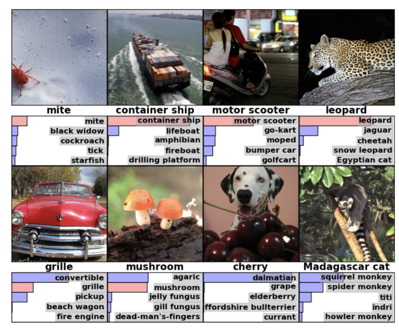
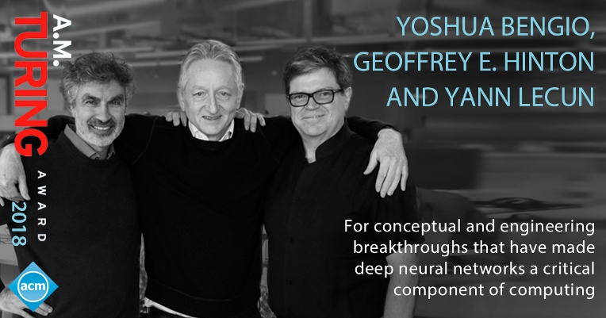
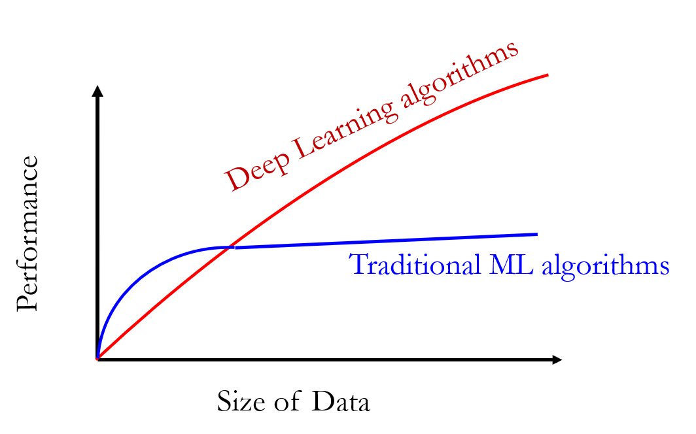

```{python}
#| label: setup
import numpy as np
import matplotlib.pyplot as plt

BLUE, ORANGE, GREY, INK = "#1f4fd8", "#E8833A", "#888888", "#222222"
plt.rcParams.update({"font.size": 13, "axes.spines.top": False, "axes.spines.right": False,
                     "axes.edgecolor": "#999999", "xtick.color": "#555555", "ytick.color": "#555555"})
```

## Agenda

-   What deep learning is, and how it connects to the networks we just built
-   **Part 1. The breakthroughs:** from ImageNet in 2009 to the models of November 2026
-   **Part 2. Why now?** Data, hardware, software and better ideas
-   **Part 3. The toolbox:** which network for which job, and when not to use deep learning
-   **Part 4. Limits and risks**
-   Python examples

## What Is Deep Learning?

:::: {.columns}
::: {.column width="52%"}
::: {.nest .n1}
**Artificial intelligence:** any technique that makes computers act intelligently

::: {.nest .n2}
**Machine learning:** learning patterns from data, without explicit rules. Trees, forests, boosting, LASSO.

::: {.nest .n3}
**Deep learning:** machine learning with neural networks that have many hidden layers
:::
:::
:::
:::

::: {.column width="48%"}
-   You already know the building block: each node adds its weighted inputs, then applies an activation function.
-   "Deep" just means many layers. Our Network 5 has 3 hidden layers. ResNet-152 has 150 weight layers between its first and its output.
-   The main practical gain: deep networks **learn their own features** from raw pixels, words or sound. With trees and LASSO, we usually choose the inputs ourselves.
:::
::::

::: {.key}
Same idea as our small networks, on a vastly larger scale: 15 parameters in Network 3, and 175 billion in GPT-3.
:::

# Part 1. The Breakthroughs

## 2009: ImageNet

:::: {.columns}
::: {.column width="42%"}
-   A public dataset of about **15 million** labeled images in about **22,000** categories
-   Its yearly competition (2010 to 2017) used a subset: about 1.2 million training images and **1,000** categories
-   Models are scored by **top-5 error**: how often the correct label is missing from the model's five best guesses

::: {.key}
Before ImageNet, models were compared on far smaller datasets. A big shared test made progress easy to see.
:::
:::

::: {.column width="58%"}

:::
::::

## 2012: AlexNet Changes the Field

```{python}
years = ["2010", "2011", "2012\nAlexNet", "2013", "2014\nGoogLeNet", "2015\nResNet", "2016", "2017", "Human\n(one test)"]
err = [28.2, 25.8, 15.3, 11.7, 6.7, 3.57, 2.99, 2.25, 5.1]
fig, ax = plt.subplots(figsize=(12.4, 4.3))
colors = [GREY, GREY] + [BLUE] * 6 + [ORANGE]
ax.bar(years, err, color=colors, width=0.62)
for x, v in enumerate(err):
    ax.text(x, v + 0.6, f"{v:g}%", ha="center", fontsize=13, color=INK)
for x, txt in [(2, "8 layers"), (4, "22 layers"), (5, "152 layers")]:
    ax.text(x, err[x] + 3.1, txt, ha="center", fontsize=12.5, color=BLUE, fontweight="bold")
ax.set_ylabel("Top-5 error, winning entry")
ax.set_ylim(0, 32)
ax.set_yticks([0, 10, 20, 30])
ax.yaxis.grid(True, color="#eeeeee")
ax.set_axisbelow(True)
ax.tick_params(length=0)
ax.spines["left"].set_visible(False)
fig.tight_layout()
plt.show()
```

-   In 2012, the second-place team had **26.2%** error. AlexNet, a deep convolutional network trained on GPUs, had **15.3%**.
-   Grey bars are not deep learning. Every winner from 2012 on was. By 2015, models passed the often-cited human figure of 5.1%, from one person's test on a sample of images.

## 2014 to 2017: Deep Learning Reaches Products

| Year | System | What happened |
|:--:|:------:|:------------------:|
| 2014 | DeepFace (Facebook) | 97.35% accuracy on a standard face-matching benchmark, close to human level |
| 2015–2016 | AlphaGo (DeepMind) | First program to beat a professional Go player (2015), then world-class player Lee Sedol, 4 games to 1 (2016) |
| 2016 | Google Translate | Moved from phrase-based translation to a neural network system, with a large jump in quality |
| 2017 | Face ID (Apple) | Face recognition on the iPhone, run by a deep network on the device |

::: {.key}
Google Translate and Face ID show a pattern: companies **replaced** years of hand-built systems with deep learning once it won.
:::

## 2017: The Transformer

:::: {.columns}
::: {.column width="55%"}
-   A Google paper, *Attention Is All You Need*, introduced the **Transformer**.
-   **Attention** lets each word look at the other words and decide which ones matter for understanding it.
-   In "The bat flew out of the cave because **it** was dark", attention helps the model work out what "it" refers to.
-   It can process a whole sequence at once, which suits GPUs very well.
:::

::: {.column width="45%"}
| Model | Year | Parameters |
|:----:|:--:|:------:|
| BERT (base) | 2018 | 109.5 million |
| GPT-2 (largest) | 2019 | 1.5 billion |
| GPT-3 (largest) | 2020 | 175 billion |
| Today's frontier models | 2026 | generally not published |
:::
::::

::: {.key}
Nearly all of today's language models are built on this idea. This is the "T" in GPT: Generative Pre-trained **Transformer**. We build a small one in Part 4 of the course.
:::

## 2020 to 2024: The Generative Era

| Year | Milestone | Why it matters |
|:--:|:------:|:------------------:|
| 2020 | GPT-3 | Scale alone gave a large jump: 175 billion parameters |
| 2020 | AlphaFold 2 | Predicted protein structures at close to experimental accuracy |
| 2022 | Diffusion image models | Generate realistic images from a text description |
| Nov. 2022 | ChatGPT | Brought language models to the general public |
| 2024 | AlphaFold 3 | Extended prediction to DNA, RNA and other molecules |
| 2024 | Sora | Text-to-video, for clips up to a minute long |

::: {.key}
The focus widened from **predicting** a label to **generating** new text, images, video and molecules.
:::

## Science Takes Notice

:::: {.columns}
::: {.column width="56%"}
| Year | Award | Winners | For |
|:--:|:----:|:------:|:------:|
| 2018 | Turing Award | Bengio, Hinton, LeCun | Deep neural networks |
| 2024 | Nobel Prize in Physics | Hopfield, Hinton | Foundations of machine learning with artificial neural networks |
| 2024 | Nobel Prize in Chemistry | Baker; Hassabis, Jumper | Protein design; protein structure prediction (AlphaFold) |
| 2024 | Turing Award | Barto, Sutton | Reinforcement learning |
:::

::: {.column width="44%"}

:::
::::

-   AlphaFold has been used by over **3 million researchers** in more than 190 countries, according to Google.
-   Deep learning is now a tool for doing science, as well as a subject of it.

## 2025: Reasoning, Agents and the Real World

-   **Mathematics.** At the 2025 International Mathematical Olympiad, experimental models from Google DeepMind and OpenAI each solved 5 of 6 problems, reaching the gold-medal score of 35 out of 42.
-   **Video.** Google's Veo 3 added synchronized sound to generated video.
-   **Self-driving.** Waymo passed 450,000 paid rides per week by December 2025, up from about 175,000 a year earlier.
-   **Open models.** Chinese labs such as DeepSeek released strong models whose weights anyone can download.
-   **Agents.** Models moved from answering questions to carrying out multi-step tasks: writing and testing code, or operating a computer.

::: {.key}
The common thread: models moved from answering a single question toward completing longer tasks.
:::

## Where Things Stand: November 2026

| Company | Latest models | Announced |
|:----:|:--------:|:------:|
| OpenAI | GPT-6 Astra, GPT-6 Sol and Luna, GPT-6.1 | September–October 2026 |
| Google DeepMind | Gemini 4 Argon, Gemini 4 Carbon (pre-release testing) | Sep. 30 and Oct. 28, 2026 |
| Anthropic | Claude Opus 5.5, Sonnet 5.5, Haiku 5.5 | Sep. 22, Sep. 28 and Oct. 7, 2026 |

-   Other major developers include xAI, Meta, Alibaba and DeepSeek. In the Stanford AI Index, the U.S. lead over the best Chinese model had shrunk to **2.7%** by March 2026.
-   Industry produced **over 90%** of notable frontier models in 2025, so academia no longer leads at the frontier.
-   These companies generally no longer publish parameter counts or architecture details. The table of well-known networks in our last deck stops at GPT-3 for that reason.

::: {.key}
This table will be out of date within months. Every model in it was announced in the past 10 weeks.
:::

## What Models Can and Cannot Do

| Test (Stanford AI Index 2026) | Result |
|:-------------:|:--------:|
| **SWE-bench Verified:** fix real software bugs | From 60% to near 100% in one year |
| **OSWorld:** carry out tasks on a computer | 66.3%, against a human baseline of 72.35% |
| **Math Olympiad problems** | Gold-medal level |
| **Reading an analog clock** | Correct only 50.1% of the time |

::: {.key}
Progress is uneven. A model can match top students in olympiad mathematics and still misread a clock, so test it on **your** task before trusting it.
:::

# Part 2. Why Now?

## Neural Networks Are Old. Why Now?

:::: {.columns}
::: {.column width="38%"}
| Year | Idea |
|:--:|:------:|
| 1958 | Perceptron |
| 1986 | Backpropagation popularized |
| 1998 | LeNet-5 reads handwritten digits |
| 2012 | AlexNet wins ImageNet |
:::

::: {.column width="62%"}
The main ideas existed decades before they worked at scale. Four things had to come together:

1.  **Data:** enough examples to train millions of parameters
2.  **Hardware:** chips that can do the arithmetic quickly
3.  **Software:** tools that make building networks practical
4.  **Better ideas:** ways to train networks with many layers
:::
::::

::: {.key}
Compare LeNet-5 with AlexNet: a similar basic design, but about 1,000 times the parameters (60,000 vs. 61 million), trained on much more data with GPUs.
:::

## Ingredient 1: Data

:::: {.columns}
::: {.column width="55%"}
-   **Images:** LeNet-5 trained on 60,000 small digit images. AlexNet trained on about 1.2 million photos.
-   **Text:** language models train on enormous collections from the public web and licensed sources.
-   **The main difference from older methods:** as data grows, deep networks can keep improving, while many traditional methods level off.
-   **Now a real constraint:** companies compete for licensed data, and copyright is being argued in court.
:::

::: {.column width="45%"}

:::
::::

::: {.note}
The curves in the figure show the idea only; they are not measured data. With small datasets, traditional methods are often better.
:::

## Ingredient 2: Hardware

:::: {.columns}
::: {.column width="56%"}
```{python}
t = np.arange(0, 7)
ai = 5.0 ** t
moore = 2.0 ** (t / 2)
assert round(ai[-1]) == 15625 and round(moore[-1]) == 8
fig, ax = plt.subplots(figsize=(7.6, 4.7))
ax.plot(2020 + t, ai, color=BLUE, lw=2.4, marker="o", ms=7)
ax.plot(2020 + t, moore, color=ORANGE, lw=2.4, marker="s", ms=7)
ax.text(2025.9, 15625 * 1.6, "Frontier training compute:\n5× per year", ha="right", va="bottom", color=INK, fontsize=13)
ax.text(2026, 8 * 2.0, "Doubling every\n2 years", ha="right", va="bottom", color=INK, fontsize=13)
ax.set_yscale("log")
ax.set_ylim(0.8, 2e5)
ax.set_ylabel("Compute relative to 2020 (log scale)")
ax.set_yticks([1, 10, 100, 1000, 10000, 100000])
ax.set_yticklabels(["1", "10", "100", "1,000", "10,000", "100,000"])
ax.minorticks_off()
ax.yaxis.grid(True, color="#eeeeee")
ax.set_axisbelow(True)
ax.tick_params(length=0)
ax.spines["left"].set_visible(False)
fig.tight_layout()
plt.show()
```

::: {.note}
Lines show what each growth rate implies, not measurements of individual models. Rate from Epoch AI.
:::
:::

::: {.column width="44%"}
-   Training compute for frontier language models has grown about **5× per year** since 2020, doubling every 5.2 months.
-   Six years at that rate is about **15,000×**. Doubling every two years gives only 8×.
-   **GPUs** do the matrix arithmetic of neural networks in parallel, which is why they replaced ordinary processors.
-   The largest known AI data center has compute equal to about **1.1 million** NVIDIA H100 chips (Epoch AI).
-   AlexNet was trained on **two** gaming GPUs.
:::
::::

## The Money Behind It

:::: {.columns}
::: {.column width="50%"}
| Measure | Figure |
|:---------:|:----:|
| Frontier training cost growth | 3.5× per year since 2020 |
| Private AI investment, U.S., 2025 | $285.9 billion |
| Private AI investment, Europe, 2025 | $20.9 billion |
| Private AI investment, China, 2025 | $12.4 billion |
| Up-front cost of a 1-gigawatt data center | About $38 billion |
:::

::: {.column width="50%"}
-   Frontier AI labs have raised more than **$370 billion** (Epoch AI).
-   Training cost grows more slowly than compute (3.5× vs. 5× per year), so each unit of compute is getting cheaper.
-   U.S. private investment was more than 23 times China's in 2025, yet the gap between their best models is small. Money alone does not decide who leads.
:::
::::

::: {.key}
You do not need this scale to use deep learning. Small models and pre-trained models run on a laptop or in free Colab, as we will see in Image Recognition.
:::

## Ingredient 3: Software

| Then | Now |
|:---------:|:---------:|
| TensorFlow (Google, 2015) was the leading framework | **PyTorch** dominates research: blog surveys estimate about 85% of deep learning papers |
| PyTorch was a Facebook project (2016) | PyTorch is run by an independent foundation, and Facebook is now Meta |
| Google had two separate labs: Google Brain and DeepMind | They merged into **Google DeepMind** in April 2023 |
| Researchers wrote and trained their own models | Pre-trained models can be downloaded (Hugging Face) or called through an API |

-   A small network now takes a few lines of Python, and AI assistants can draft them.
-   **Open weights** matter too: anyone can download and run models from Meta, DeepSeek, Alibaba and others.

## Ingredient 4: Better Ideas

Deep networks were long considered too hard to train. A series of ideas changed that:

| Idea | Year | What it does, in plain words |
|:----:|:--:|:------------:|
| **ReLU activation** | 2010–2012 | Simple function, $\max(0, z)$, that trains far faster than sigmoid in deep networks |
| **Dropout** | 2012 | Randomly switches off nodes during training, which reduces overfitting |
| **Batch normalization** | 2015 | Keeps the values in each layer in a stable range |
| **Residual connections** | 2015 | Shortcuts past layers, which made 152 layers trainable |
| **Attention** | 2014–2017 | Lets a model focus on the most relevant parts of its input |
| **Pre-training and fine-tuning** | 2018 on | Learn from huge data first, then adjust for a specific task |

::: {.key}
Notice how familiar these are: ReLU is from our last deck, and dropout fights the same **overfitting** we have studied since week 1.
:::

# Part 3. The Toolbox

## Which Network for Which Job?

| Architecture | Built for | Key idea | Examples | In this course |
|:------:|:----:|:----------:|:------:|:----:|
| **Fully connected** | Fixed-size inputs | Every node connects to the next layer | Networks 1 to 5 | Done |
| **Convolutional (CNN)** | Images | Small filters slide across the image | AlexNet, ResNet | Image Recognition |
| **Recurrent (RNN, LSTM)** | Sequences | Reads one step at a time, with memory | Translation before 2017 | Mostly replaced by Transformers |
| **Transformer** | Text, and now images | Attention across the whole input | GPT, Gemini, Claude | Large Language Models |
| **Diffusion** | Generating images and video | Learns to remove noise step by step | Image and video generators | Mentioned only |

::: {.key}
All of them use the same recipe from our framework: choose a model function, define a loss, and find the weights by gradient descent.
:::

## When Not to Use Deep Learning

:::: {.columns}
::: {.column width="50%"}
**Use deep learning for:**

-   Images, audio, video and text
-   Very large datasets
-   Tasks where a good pre-trained model already exists
:::

::: {.column width="50%"}
**Consider something simpler for:**

-   **Tabular data** like spreadsheets: random forests and gradient boosting are often as good or better, and need less tuning
-   Small datasets
-   Decisions you must explain: LASSO and small trees are easier to read
:::
::::

::: {.key}
The tree models from earlier in the course are not obsolete. On tables of data, gradient boosting remains a strong first choice (Grinsztajn et al., 2022). **Start simple**, and use the baseline to judge whether a neural network is worth it.
:::

# Part 4. Limits and Risks

## Limits and Risks

| Issue | What it means | Evidence or example |
|:------:|:------------:|:------------:|
| **Confident mistakes** | Language models can state false things convincingly | Always check citations and numbers |
| **Incidents** | Real-world harms are growing with use | Documented AI incidents: 233 in 2024, 362 in 2025 |
| **Black boxes** | Billions of parameters are hard to explain | Recall our long formulas, with only 25 parameters |
| **Transparency** | Companies disclose less about their models | Parameter counts and training data are often unpublished |
| **Energy and concentration** | Frontier models need huge data centers | A 1 GW center costs about $38 billion, so few can afford it |
| **Bias and data rights** | Models learn from their training data, flaws included | Copyright and privacy disputes are ongoing |

::: {.key}
Your job as an analyst is the same as always: define the problem, test on data the model has not seen, and report honestly what the model can and cannot do.
:::

## Python Examples

The class notebook works through three examples:

-   **Apple disease detection:** a CNN compared with gradient boosting on the same images
-   **Pneumonia detection:** classifying chest X-rays
-   **GAN (generative adversarial network):** generating new images. GANs have largely been replaced by diffusion models for image generation, but they remain a clear way to see how generative models learn.

[Open the notebook in Colab](https://colab.research.google.com/drive/1tSF1TJrGnneJ3fScV3PUQQk5PiGQuK5l?usp=sharing)

## Summary

-   Deep learning is neural networks with many layers: the same nodes we built by hand, on a far larger scale.
-   **2012:** AlexNet showed deep learning could beat everything else on ImageNet.
-   **2017:** the Transformer opened the way to today's language models.
-   **2024:** Nobel Prizes recognized both the foundations and AlphaFold.
-   **2026:** frontier models write code, operate computers and reach olympiad-level mathematics, and they still misread clocks.
-   **Why now?** Data, hardware, software and better ideas, with training compute growing about 5× per year.
-   Deep learning is the right tool for images, text and audio. For tables of data, start with the simpler models from earlier in the course.

**Next:** Image Recognition, where we look inside a CNN.

## Sources

::: {.sources}
-   [Stanford HAI, 2026 AI Index Report](https://hai.stanford.edu/ai-index/2026-ai-index-report): adoption, benchmarks, investment, incidents, industry share, U.S.–China gap
-   [Epoch AI, Trends in AI](https://epoch.ai/trends) (updated Feb. 5, 2026): training compute, training cost, data centers
-   [OpenAI, GPT-6 Astra](https://openai.com/index/gpt-6-astra/) and [GPT-6 Sol and Luna](https://openai.com/index/introducing-gpt-6-sol-and-luna/)
-   [Google, Gemini 4 Argon](https://blog.google/innovation-and-ai/models-and-research/gemini-models/gemini-4-argon/) and [Gemini 4 Carbon](https://blog.google/innovation-and-ai/models-and-research/gemini-models/introducing-gemini-4-carbon/)
-   [Anthropic news](https://www.anthropic.com/news): Claude Opus 5.5, Sonnet 5.5, Haiku 5.5
-   [Google, 2025 research breakthroughs](https://blog.google/innovation-and-ai/products/2025-research-breakthroughs/): AlphaFold usage and AlphaEvolve
-   [CNBC, Waymo passes 450,000 weekly paid rides](https://www.cnbc.com/2025/12/08/waymo-paid-rides-robotaxi-tesla.html) (December 2025)
-   Krizhevsky, Sutskever and Hinton (2012), *ImageNet Classification with Deep Convolutional Neural Networks*
-   Vaswani et al. (2017), *Attention Is All You Need*
-   Grinsztajn, Oyallon and Varoquaux (2022), *Why Do Tree-Based Models Still Outperform Deep Learning on Typical Tabular Data?*
-   Russakovsky et al. (2015), *ImageNet Large Scale Visual Recognition Challenge*: yearly winners and the human comparison
-   [JetBrains, PyTorch vs. TensorFlow in 2026](https://blog.jetbrains.com/pycharm/2026/05/pytorch-vs-tensorflow-choosing-framework-2026/): framework trends (the 85% figure is an estimate from blog sources)
:::
