```{python}
#| label: setup
import numpy as np
import matplotlib.pyplot as plt
from matplotlib.colors import ListedColormap
from sklearn.datasets import make_moons
from sklearn.model_selection import train_test_split
from sklearn.neighbors import KNeighborsClassifier

BLUE, ORANGE, GREEN, GREY, INK = "#1f4fd8", "#E8833A", "#1a7f37", "#888888", "#222222"
plt.rcParams.update({"mathtext.fontset": "cm", "font.size": 13,
                     "axes.spines.top": False, "axes.spines.right": False})

# Two noisy, interleaving classes: class 1 = "x" (orange), class 0 = "o" (blue)
X, y = make_moons(n_samples=300, noise=0.35, random_state=1)
X_train, X_test, y_train, y_test = train_test_split(X, y, test_size=0.4, random_state=1)
```

## {.center}


## {.center}


## Example: 1-Nearest Neighbor

::: {.r-stack}
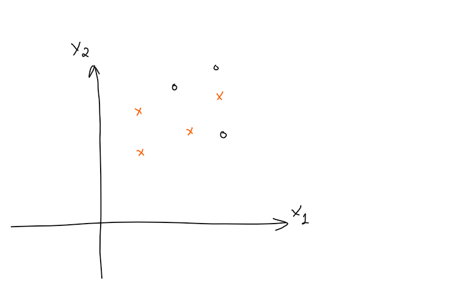

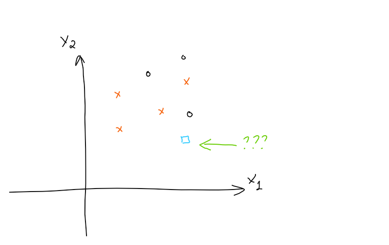{.fragment fragment-index=1}

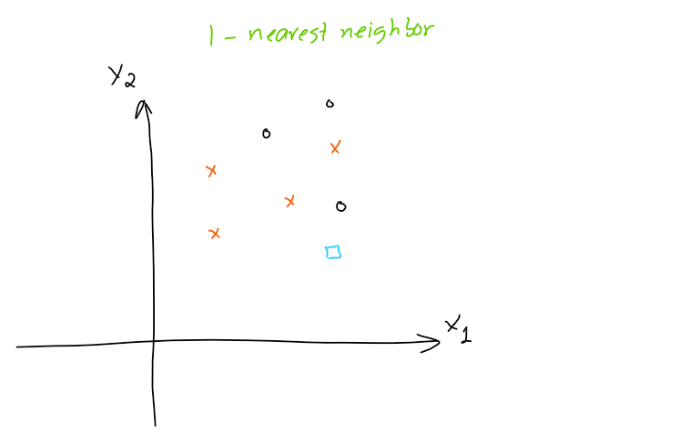{.fragment fragment-index=2}

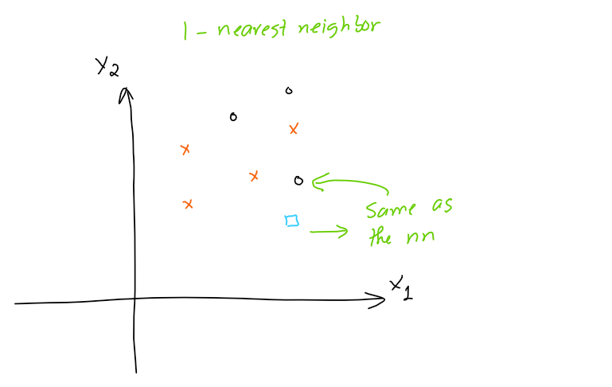{.fragment fragment-index=3}

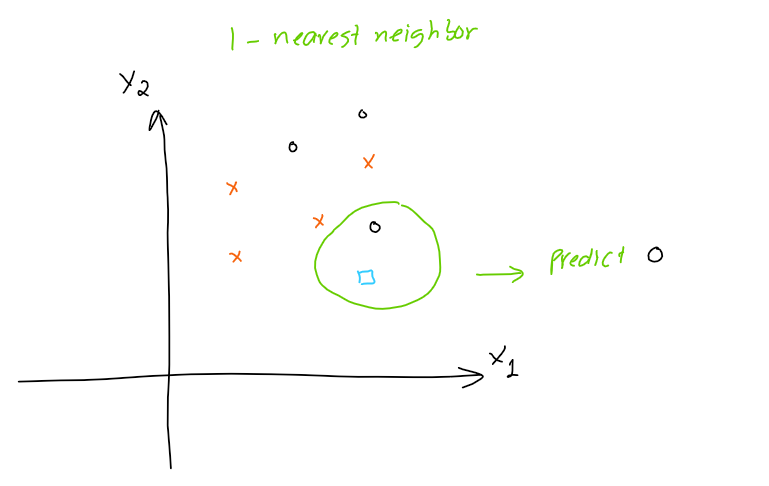{.fragment fragment-index=4}
:::

::: {.r-stack .caption-stack}
[Given the training data.]{.fragment .fade-out fragment-index=1}

[Predict the class of the new sample.]{.fragment .fade-in-then-out fragment-index=1}

["You are as good as your best (closest) friend!"]{.fragment .fade-in-then-out fragment-index=2}

[Find its single nearest neighbor.]{.fragment .fade-in-then-out fragment-index=3}

[The 1NN model classifies the new sample as $o$, since its nearest neighbor is an $o$.]{.fragment fragment-index=4}
:::

## Example: 3-Nearest Neighbors

::: {.r-stack}
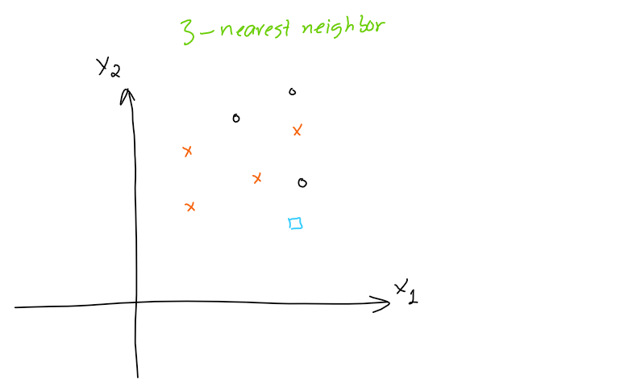

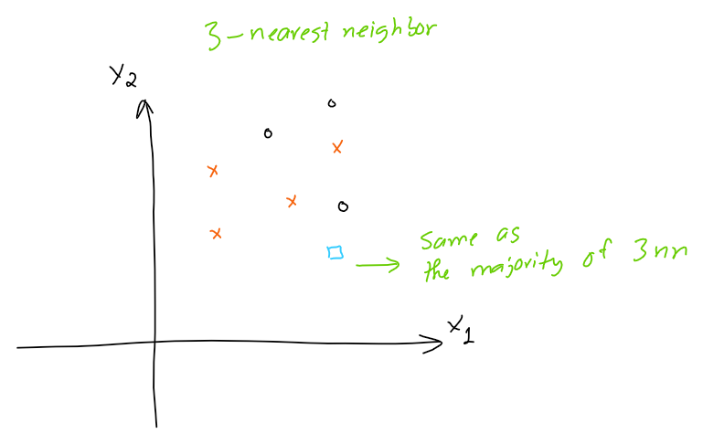{.fragment fragment-index=1}

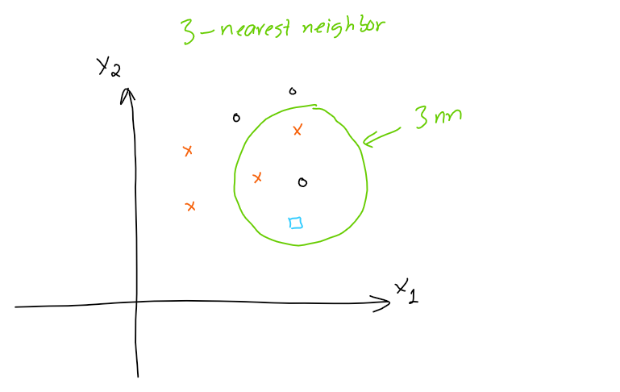{.fragment fragment-index=2}

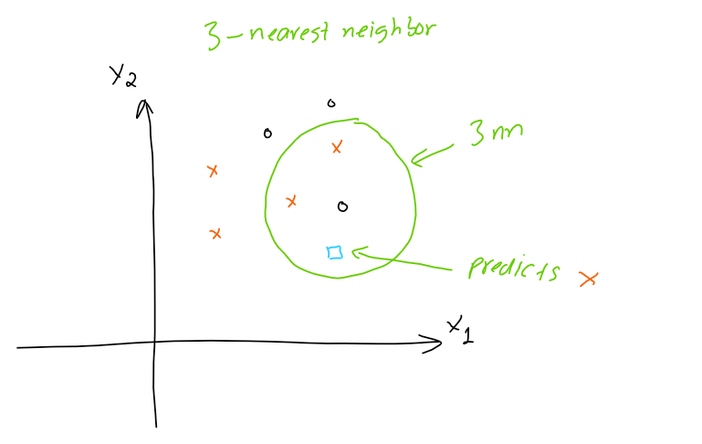{.fragment fragment-index=3}
:::

::: {.r-stack .caption-stack}
[Now look at the 3 nearest neighbors.]{.fragment .fade-out fragment-index=1}

[Grow the neighborhood...]{.fragment .fade-in-then-out fragment-index=1}

[...until it contains 3 training points.]{.fragment .fade-in-then-out fragment-index=2}

[The 3NN model classifies the new sample as $x$, since the majority (2 of 3) of its nearest neighbors are $x$.]{.fragment fragment-index=3}
:::

## KNN: Prediction Rule

- **Prediction rule**: look at the $K$ training examples most similar (closest) to the new point.
- For **classification**: predict the *majority* class among the $K$ neighbors (majority vote).
- For **regression**: predict the *average* response of the $K$ neighbors.

::: {.key}
KNN has no training step: the "model" is the training data itself. All the work happens at prediction time (a *lazy* learner).
:::

## KNN Algorithm

- **Step 1**: Standardize the variables (compute the scaling from the *training* data, then apply the same scaling to the test point).
- **Step 2**: Compute the distance from the test point to every training point.
- **Step 3**: Sort the distances in ascending order.
- **Step 4**: Select the $K$ training points with the smallest distances: the $K$ nearest neighbors.
- **Step 5**: Use majority vote (classification) or averaging (regression).

## Algorithm Requirements

The algorithm requires:

- **Tuning parameter $K$**: the number of nearest neighbors to use.
- **Distance function**: to measure how similar two examples are.

## Two Ways to Measure "Close"

```{python}
#| fig-width: 15
#| fig-height: 5.6
from matplotlib.patches import Arc
P, Q = np.array([1.5, 4.0]), np.array([5.0, 2.0])
fig, (axL, axR) = plt.subplots(1, 2, figsize=(15, 5.6))
for ax in (axL, axR):
    ax.set_xlim(-0.4, 6.4); ax.set_ylim(-0.4, 5.2); ax.set_aspect("equal")
    ax.set_xticks([]); ax.set_yticks([])
    ax.scatter(0, 0, color=INK, s=25, zorder=5)
    ax.text(-0.15, -0.35, "origin", fontsize=12, color=GREY)

# Left: the straight line between the two points
axL.plot(*zip(P, Q), color=GREEN, lw=3, ls="--")
axL.text(*(P + Q) / 2 + np.array([0.25, 0.25]), "distance", fontsize=17, color=GREEN, fontweight="bold")
for v, name, c in [(P, "A", BLUE), (Q, "B", ORANGE)]:
    axL.scatter(*v, s=260, color=c, zorder=5, edgecolor="white", lw=1.5)
    axL.text(v[0] + 0.2, v[1] + 0.15, name, fontsize=18, color=c, fontweight="bold")
axL.set_title("Euclidean distance:\nhow LONG is the line between them?", fontsize=18)

# Right: arrows from the origin and the angle between them
for v, name, c in [(P, "A", BLUE), (Q, "B", ORANGE)]:
    axR.annotate("", xy=v, xytext=(0, 0), arrowprops=dict(arrowstyle="-|>", color=c, lw=3, mutation_scale=22))
    axR.text(v[0] + 0.2, v[1] + 0.15, name, fontsize=18, color=c, fontweight="bold")
aP, aQ = np.degrees(np.arctan2(P[1], P[0])), np.degrees(np.arctan2(Q[1], Q[0]))
axR.add_patch(Arc((0, 0), 2.4, 2.4, theta1=aQ, theta2=aP, color=GREEN, lw=3))
mid = np.radians((aP + aQ) / 2)
axR.text(1.45 * np.cos(mid), 1.45 * np.sin(mid), "angle", fontsize=17, color=GREEN, fontweight="bold")
axR.set_title("Cosine similarity:\nhow SMALL is the angle between them?", fontsize=18)
plt.tight_layout()
plt.show()
```

:::: {.columns}
::: {.column width="50%"}
- **Short line** = close.
- Cares about *where* the points are.
:::
::: {.column width="50%"}
- **Small angle** = close (similarity near 1).
- Cares only about the *direction* the points are in, not how far out they are.
:::
::::

## Same Points, Different Nearest Neighbor

```{python}
#| fig-width: 15
#| fig-height: 4.8
PA, PB, PC = np.array([1.2, 1.6]), np.array([2.6, 0.8]), np.array([3.2, 4.9])
cosv = lambda u, v: u @ v / (np.linalg.norm(u) * np.linalg.norm(v))
assert np.linalg.norm(PA - PB) < np.linalg.norm(PA - PC) and cosv(PA, PC) > cosv(PA, PB)
PTS3 = [(PA, "A", INK), (PB, "B", BLUE), (PC, "C", ORANGE)]

fig, (axL, axR) = plt.subplots(1, 2, figsize=(15, 4.8))
for ax in (axL, axR):
    ax.set_xlim(-0.4, 5.2); ax.set_ylim(-0.4, 5.4); ax.set_aspect("equal")
    ax.set_xticks([]); ax.set_yticks([])
    ax.scatter(0, 0, color=INK, s=25, zorder=5)
    ax.text(-0.15, -0.35, "origin", fontsize=12, color=GREY)

# Left: lines from A to B and from A to C
axL.plot(*zip(PA, PB), color=GREEN, lw=3.5)
axL.plot(*zip(PA, PC), color=GREY, lw=2, ls="--")
axL.text(*(PA + PB) / 2 + np.array([-0.6, -0.6]), "short", fontsize=16, color=GREEN, fontweight="bold")
axL.text(*(PA + PC) / 2 + np.array([-0.85, 0.1]), "long", fontsize=16, color=GREY, fontweight="bold")
for v, name, c in PTS3:
    axL.scatter(*v, s=260, color=c, zorder=5, edgecolor="white", lw=1.5)
    axL.text(v[0] + 0.18, v[1] + 0.12, name, fontsize=18, color=c, fontweight="bold")
axL.set_title("Euclidean distance", fontsize=18)

# Right: arrows from the origin and the angles A-B and A-C
for v, name, c in PTS3:
    axR.annotate("", xy=v, xytext=(0, 0), arrowprops=dict(arrowstyle="-|>", color=c, lw=3, mutation_scale=22))
    axR.text(v[0] + 0.18, v[1] + 0.12, name, fontsize=18, color=c, fontweight="bold")
deg = lambda v: np.degrees(np.arctan2(v[1], v[0]))
axR.add_patch(Arc((0, 0), 1.6, 1.6, theta1=deg(PB), theta2=deg(PA), color=GREY, lw=2.5))
axR.text(0.9, 0.62, "wide", fontsize=16, color=GREY, fontweight="bold")
axR.add_patch(Arc((0, 0), 5.2, 5.2, theta1=deg(PA), theta2=deg(PC), color=GREEN, lw=4))
axR.text(1.75, 2.1, "tiny", fontsize=16, color=GREEN, fontweight="bold")
axR.set_title("Cosine similarity", fontsize=18)
plt.tight_layout()
plt.show()
```

**Question:** What is the nearest neighbor of A?

:::: {.columns}
::: {.column .fragment width="50%"}
- Length matters: C is farther out, so it is far from A.
- **Closest neighbor of A is B.**
:::
::: {.column .fragment width="50%"}
- Length does not matter: only the direction counts.
- **Closest neighbor of A is C.**
:::
::::

::: {.key .fragment}
The two measures can pick **different** nearest neighbors, so KNN can give different predictions depending on which one we use.
:::

## The Range of Cosine Similarity: From $-1$ to $1$

```{python}
#| output: false
def arrow(ax, v, color, label, dx=0.08, dy=0.08):
    ax.annotate("", xy=v, xytext=(0, 0), arrowprops=dict(arrowstyle="-|>", color=color, lw=2.8, mutation_scale=20))
    ax.text(v[0] + dx, v[1] + dy, label, color=color, fontsize=16, fontweight="bold")

cases = [("angle 0°:  cos = 1\nMOST similar", (1, 0.5), (3, 1.5), (-0.1, -0.5), GREEN),
         ("angle 90°:  cos = 0\nnothing in common", (2, 1), (-0.75, 1.5), (0.08, 0.08), GREY),
         ("angle 180°:  cos = −1\nLEAST similar (opposite)", (1.5, 1), (-1.5, -1), (0.08, 0.08), "#b5302a")]
def cos_range_fig(n_titles, show_line=False):
    # Same layout every time; titles past n_titles are drawn invisible so the images line up.
    fig = plt.figure(figsize=(15, 6.4))
    gs = fig.add_gridspec(2, 3, height_ratios=[4, 1.1], hspace=0.15)
    for col, (title, a, b, off, tc) in enumerate(cases):
        ax = fig.add_subplot(gs[0, col])
        arrow(ax, a, BLUE, "A", dx=off[0], dy=off[1])
        arrow(ax, b, ORANGE, "B")
        ax.scatter([0], [0], color=INK, s=20, zorder=5)
        if col == 1:
            sq = 0.28 * np.array([2, 1]) / np.sqrt(5), 0.28 * np.array([-0.75, 1.5]) / np.hypot(0.75, 1.5)
            ax.plot([sq[0][0], sq[0][0] + sq[1][0], sq[1][0]], [sq[0][1], sq[0][1] + sq[1][1], sq[1][1]], color=INK, lw=1.2)
        ax.set_xlim(-2, 3.6); ax.set_ylim(-1.4, 2)
        ax.set_aspect("equal"); ax.set_xticks([]); ax.set_yticks([])
        ax.spines["left"].set_visible(False); ax.spines["bottom"].set_visible(False)
        ax.set_title(title, fontsize=16, color=tc, fontweight="bold", alpha=1 if col < n_titles else 0)

    # Number line from -1 to 1
    ax = fig.add_subplot(gs[1, :])
    xs = np.linspace(-1, 1, 300)
    ax.scatter(xs, np.zeros_like(xs), c=xs, cmap="RdYlGn", s=90, marker="s", linewidths=0)
    for x, lab in [(-1, "−1\nleast similar\n(opposite)"), (0, "0\nunrelated\n(perpendicular)"), (1, "1\nmost similar\n(same direction)")]:
        ax.plot([x, x], [-0.15, 0.15], color=INK, lw=2)
        ax.text(x, -0.3, lab, ha="center", va="top", fontsize=14)
    ax.text(-1.32, 0, "cosine\nsimilarity", ha="center", va="center", fontsize=14, fontweight="bold")
    ax.set_xlim(-1.5, 1.2); ax.set_ylim(-1.3, 0.3); ax.axis("off")
    if not show_line:  # draw the number line invisible so every image keeps the same size
        for artist in ax.collections + ax.lines + ax.texts:
            artist.set_alpha(0)
    fig.savefig(f"images/knn_fa26/cos_range_{n_titles + show_line}.png", dpi=150, bbox_inches="tight", facecolor="white")
    plt.close(fig)

for n in range(4):
    cos_range_fig(n)
cos_range_fig(3, show_line=True)
```

::: {.r-stack}
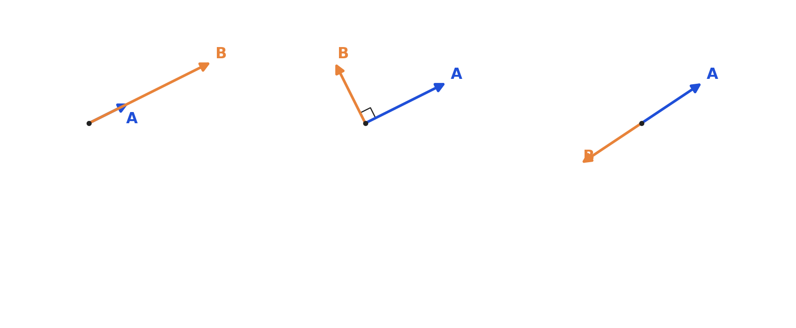

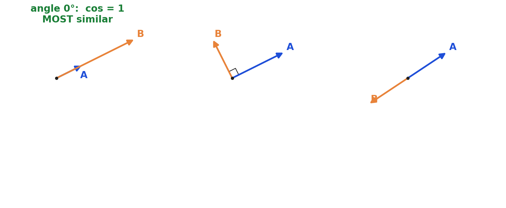{.fragment}

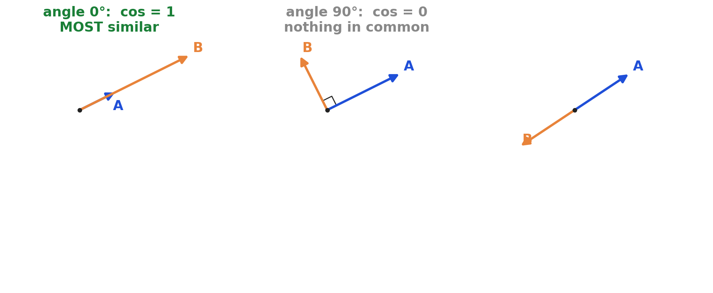{.fragment}

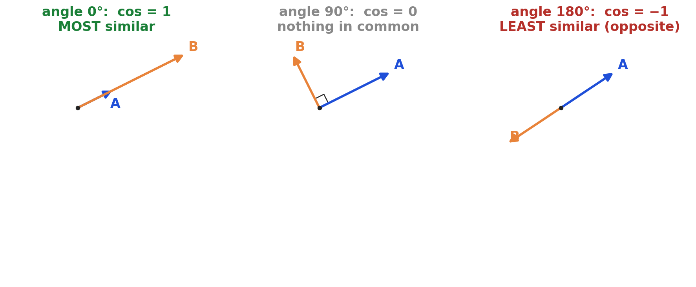{.fragment}

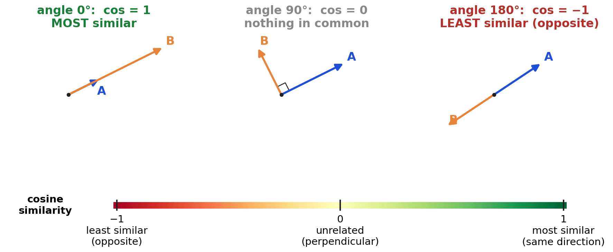{.fragment}
:::


## Using Cosine Similarity in KNN

The algorithm is the same. Only Steps 2–4 change:

- **Step 2**: Compute the **cosine similarity** between the test point and every training point.
- **Step 3**: Sort the similarities in **descending** order (largest first).
- **Step 4**: The $K$ nearest neighbors are the $K$ training points with the **largest** similarities.
- **Step 5**: Majority vote (classification) or average (regression), as before.

Equivalently, use cosine distance $1 - \cos$ and keep the original "smallest first" algorithm.

## When Is Cosine the Better Choice?

::: {.check}
When the *pattern* (the mix of the variables) matters but the overall *size* does not:

- word counts in documents (a long article and a short one on the same topic),
- ratings or purchases (a heavy user and a light user with the same taste),
- embeddings (song, movie, or text vectors in modern recommender systems).
:::

## Example: Sports or Politics?

```{python}
DOCS = {"A": (8, 2, "Sports"), "B": (10, 3, "Sports"), "C": (6, 1, "Sports"),
        "D": (1, 3, "Politics"), "E": (2, 5, "Politics")}
NEW = np.array([3, 1])
VEC = {k: np.array(v[:2]) for k, v in DOCS.items()}
EUC = {k: float(np.linalg.norm(NEW - v)) for k, v in VEC.items()}
COS = {k: float(NEW @ v / (np.linalg.norm(NEW) * np.linalg.norm(v))) for k, v in VEC.items()}
EUC_NN = sorted(DOCS, key=lambda k: EUC[k])[:3]
COS_NN = sorted(DOCS, key=lambda k: -COS[k])[:3]
assert EUC_NN == ["D", "C", "E"] and COS_NN == ["B", "A", "C"]

COL = {"Sports": ORANGE, "Politics": BLUE}
from matplotlib.patches import Wedge

def base(ax, title):
    for k, (a, b, c) in DOCS.items():
        ax.scatter(a, b, s=170, color=COL[c], zorder=4, edgecolor="white", lw=1.5)
        ax.text(a + 0.25, b + 0.15, f"{k} ({a}, {b})", fontsize=14, color=COL[c], fontweight="bold", zorder=6,
                bbox=dict(facecolor="white", edgecolor="none", alpha=0.85, pad=1))
    ax.scatter(*NEW, s=380, marker="*", color=GREEN, zorder=5)
    ax.text(NEW[0], NEW[1] - 0.75, "New (3, 1)", fontsize=14, color=GREEN, fontweight="bold", ha="center", zorder=6,
            bbox=dict(facecolor="white", edgecolor="none", alpha=0.85, pad=1))
    ax.set_xlim(-0.3, 12.8); ax.set_ylim(-0.3, 6.3); ax.set_aspect("equal")
    ax.set_xlabel('$x_1$ = count of "game"'); ax.set_ylabel('$x_2$ = count of "vote"')
    ax.set_title(title, fontsize=16)

def draw_euc(ax):
    base(ax, "Euclidean: nearest = D, C, E  →  Politics")
    r = EUC[EUC_NN[-1]]
    ax.add_patch(plt.Circle(NEW, r, fill=True, color=GREEN, alpha=0.08))
    ax.add_patch(plt.Circle(NEW, r, fill=False, color=GREEN, ls="--", lw=1.6))
    for k in EUC_NN:
        ax.plot(*zip(NEW, VEC[k]), color=GREEN, lw=1.8, zorder=3)
        mid = (NEW + VEC[k]) / 2
        off = {"D": (0.1, -0.55), "C": (0, 0.12), "E": (0.85, 0.3)}[k]
        ax.text(mid[0] + off[0], mid[1] + off[1], f"{EUC[k]:.2f}", fontsize=13, color=GREEN, ha="center", fontweight="bold", zorder=6,
                bbox=dict(facecolor="white", edgecolor="none", alpha=0.85, pad=1))

def draw_cos(ax):
    base(ax, "Cosine: most similar = B, A, C  →  Sports")
    ang = {k: np.degrees(np.arctan2(v[1], v[0])) for k, v in VEC.items()}
    ang_new = np.degrees(np.arctan2(NEW[1], NEW[0]))
    lo, hi = min([ang_new] + [ang[k] for k in COS_NN]), max([ang_new] + [ang[k] for k in COS_NN])
    ax.add_patch(Wedge((0, 0), 12.5, lo, hi, color=GREEN, alpha=0.12))
    for k, v in VEC.items():
        u = v / np.linalg.norm(v) * 12.5
        ax.plot([0, u[0]], [0, u[1]], color=GREEN if k in COS_NN else GREY, lw=1.8 if k in COS_NN else 1, ls="-" if k in COS_NN else ":")
    u = NEW / np.linalg.norm(NEW) * 12.5
    ax.plot([0, u[0]], [0, u[1]], color=GREEN, lw=3)
    ax.text(12.6, 4.1, "same\ndirection\nas New", fontsize=12, color=GREEN, va="center")
```

Each news article is described by how many times two words appear: $x_1$ = count of **"game"**, $x_2$ = count of **"vote"**.

| Article | $x_1$ ("game") | $x_2$ ("vote") | Class |
|:---:|:---:|:---:|:---:|
| A | 8 | 2 | Sports |
| B | 10 | 3 | Sports |
| C | 6 | 1 | Sports |
| D | 1 | 3 | Politics |
| E | 2 | 5 | Politics |
| **New** | **3** | **1** | **?** |

a. Use 3NN with **Euclidean distance** to classify the new article.

b. Use 3NN with **cosine similarity** to classify the new article.

c. The two answers differ. Which one makes more sense, and why?

## Solution (a): Euclidean Distance

Example calculation, New $= (3, 1)$ and A $= (8, 2)$:
$\; d = \sqrt{(3 - 8)^2 + (1 - 2)^2} = \sqrt{26} \approx 5.099$

```{python}
#| output: asis
rank = {k: i + 1 for i, k in enumerate(sorted(DOCS, key=lambda k: EUC[k]))}
print("| Article | $(x_1, x_2)$ | Class | Euclidean distance to New | Rank (smallest first) |")
print("|:---:|:---:|:---:|:---:|:---:|")
for k, (a, b, c) in DOCS.items():
    hi = "**" if k in EUC_NN else ""
    print(f"| {hi}{k}{hi} | ({a}, {b}) | {c} | {hi}{EUC[k]:.3f}{hi} | {rank[k]} |")
```

:::: {.columns}
::: {.column .fragment width="58%"}
```{python}
#| fig-width: 8.5
#| fig-height: 4.6
fig, ax = plt.subplots(figsize=(8.5, 4.6))
draw_euc(ax)
plt.tight_layout()
plt.show()
```
:::
::: {.column width="42%"}
- The 3 nearest neighbors are **D, C, E**: two Politics, one Sports.
- **Prediction: Politics** (2 of 3 votes).
:::
::::

## Solution (b): Cosine Similarity

Example calculation, New $= (3, 1)$ and A $= (8, 2)$:
$\; \cos = \dfrac{3 \cdot 8 + 1 \cdot 2}{\sqrt{3^2 + 1^2}\,\sqrt{8^2 + 2^2}} = \dfrac{26}{\sqrt{10}\,\sqrt{68}} \approx 0.997$

```{python}
#| output: asis
rank = {k: i + 1 for i, k in enumerate(sorted(DOCS, key=lambda k: -COS[k]))}
print("| Article | $(x_1, x_2)$ | Class | Cosine similarity with New | Rank (largest first) |")
print("|:---:|:---:|:---:|:---:|:---:|")
for k, (a, b, c) in DOCS.items():
    hi = "**" if k in COS_NN else ""
    print(f"| {hi}{k}{hi} | ({a}, {b}) | {c} | {hi}{COS[k]:.3f}{hi} | {rank[k]} |")
```

:::: {.columns}
::: {.column .fragment width="58%"}
```{python}
#| fig-width: 8.5
#| fig-height: 4.6
fig, ax = plt.subplots(figsize=(8.5, 4.6))
draw_cos(ax)
plt.tight_layout()
plt.show()
```
:::
::: {.column width="42%"}
- The 3 most similar articles are **B, A, C**: all three Sports.
- **Prediction: Sports** (3 of 3 votes).
:::
::::

## Side by Side: Euclidean vs. Cosine

```{python}
#| fig-width: 16
#| fig-height: 7
fig, (ax1, ax2) = plt.subplots(1, 2, figsize=(16, 7))
draw_euc(ax1)
draw_cos(ax2)
plt.tight_layout()
plt.show()
```

- **Euclidean** looks for points *near* the new point. **Cosine** looks for points in the same *direction* from the origin.

## Solution (c): Which Answer Makes More Sense?

| | Euclidean distance | Cosine similarity |
|:---|:---:|:---:|
| Neighbors | D, C, E | B, A, C |
| Prediction | Politics | **Sports** |
| What it compares | the actual counts | the **mix** of words |

- The new article uses "game" **3 times as often** as "vote", just like the sports articles (8:2, 10:3, 6:1).
- It is simply **short**. D and E are also short, so they are close in Euclidean distance, even though they use "vote" more than "game".
- Cosine ignores length (how many words in total) and compares the **proportions**, so it gets the topic right: **Sports**.

::: {.key}
Euclidean distance mixes up "different topic" with "different length". Cosine similarity answers only "same topic?". For word counts, ratings, and embeddings, that is usually the right question.
:::

## How Cosine Similarity Relates to Euclidean Distance

Expand the squared Euclidean distance:

$$\|\mathbf{a} - \mathbf{b}\|^2 = \|\mathbf{a}\|^2 + \|\mathbf{b}\|^2 - 2\, \mathbf{a} \cdot \mathbf{b} = \|\mathbf{a}\|^2 + \|\mathbf{b}\|^2 - 2\, \|\mathbf{a}\|\, \|\mathbf{b}\| \cos(\mathbf{a}, \mathbf{b})$$

Now **normalize** every vector to length 1: $\hat{\mathbf{a}} = \mathbf{a} / \|\mathbf{a}\|$. Then $\|\hat{\mathbf{a}}\| = \|\hat{\mathbf{b}}\| = 1$, and

$$\|\hat{\mathbf{a}} - \hat{\mathbf{b}}\|^2 = 2 - 2\cos(\mathbf{a}, \mathbf{b}) = 2\,\big(1 - \cos(\mathbf{a}, \mathbf{b})\big)$$

- When the vectors have length 1, a **larger** cosine similarity means a **smaller** Euclidean distance, always.
- So the two methods find **the same nearest neighbors** once every vector is normalized.
- The two methods only disagree when the vectors have **different lengths**, as in our example.

::: {.key}
Cosine similarity = Euclidean distance after shrinking (or stretching) every vector to length 1.
:::

## Check It on Our Example

```{python}
NHAT = NEW / np.linalg.norm(NEW)
HAT = {k: v / np.linalg.norm(v) for k, v in VEC.items()}
D_HAT = {k: float(np.linalg.norm(NHAT - h)) for k, h in HAT.items()}
for k in DOCS:
    assert abs(D_HAT[k] ** 2 - 2 * (1 - COS[k])) < 1e-12
assert sorted(DOCS, key=lambda k: D_HAT[k])[:3] == COS_NN
```

:::: {.columns}
::: {.column width="42%"}
```{python}
#| fig-width: 6.4
#| fig-height: 5.6
fig, ax = plt.subplots(figsize=(6.4, 5.6))
t = np.linspace(-0.05, np.pi / 2 + 0.05, 200)
ax.plot(np.cos(t), np.sin(t), color=GREY, lw=1, ls="--")
LBL = {"D": (0.05, 1.12), "E": (0.55, 1.08), "B": (1.2, 0.52), "A": (1.25, 0.32), "C": (1.2, 0.08)}
for k, h in HAT.items():
    c = COL[DOCS[k][2]]
    ax.plot([0, h[0]], [0, h[1]], color=c, lw=1, alpha=0.5)
    ax.scatter(*h, s=120, color=c, zorder=4, edgecolor="white")
    ax.annotate(k, xy=h, xytext=LBL[k], fontsize=15, color=c, fontweight="bold",
                arrowprops=dict(arrowstyle="-", color=c, lw=0.8))
ax.scatter(*NHAT, s=330, marker="*", color=GREEN, zorder=5)
ax.annotate("New", xy=NHAT, xytext=(0.55, 0.55), fontsize=15, color=GREEN, fontweight="bold",
            arrowprops=dict(arrowstyle="-", color=GREEN, lw=0.8))
ax.set_aspect("equal"); ax.set_xlim(-0.05, 1.45); ax.set_ylim(-0.05, 1.22)
ax.set_title("Every vector scaled to length 1", fontsize=15)
ax.set_xlabel("$x_1 / \\|\\mathbf{x}\\|$"); ax.set_ylabel("$x_2 / \\|\\mathbf{x}\\|$")
plt.tight_layout()
plt.show()
```
:::

::: {.column width="58%"}
```{python}
#| output: asis
print(f"New normalized: $({NHAT[0]:.3f}, {NHAT[1]:.3f})$\n")
print("| Article | Normalized | $\\cos$ | Distance after normalizing | $\\sqrt{2(1 - \\cos)}$ |")
print("|:---:|:---:|:---:|:---:|:---:|")
for k in sorted(DOCS, key=lambda k: -COS[k]):
    h = HAT[k]
    hi = "**" if k in COS_NN else ""
    print(f"| {hi}{k}{hi} | $({h[0]:.3f}, {h[1]:.3f})$ | {COS[k]:.3f} | {hi}{D_HAT[k]:.3f}{hi} | {np.sqrt(2 * (1 - COS[k])):.3f} |")
```

- The last two columns match, as the formula says.
- After normalizing, the 3 nearest by Euclidean distance are **B, A, C**: the same as cosine, so the prediction is **Sports**.
:::
::::

## More Ways to Measure Distance or Similarity

| Measure | Formula | Close when | Typical use |
|:---|:---:|:---:|:---|
| **Euclidean** ($L_2$) | $\sqrt{\sum (a_i - b_i)^2}$ | small | numeric variables (standardized) |
| **Manhattan** ($L_1$) | $\sum \lvert a_i - b_i \rvert$ | small | numeric; less sensitive to one large difference |
| **Minkowski** ($L_p$) | $\left(\sum \lvert a_i - b_i \rvert^p\right)^{1/p}$ | small | $p = 1$: Manhattan; $p = 2$: Euclidean |
| **Chebyshev** ($L_\infty$) | $\max_i \lvert a_i - b_i \rvert$ | small | only the single largest difference matters |
| **Cosine similarity** | $\dfrac{\mathbf{a} \cdot \mathbf{b}}{\|\mathbf{a}\|\, \|\mathbf{b}\|}$ | large | text, ratings, embeddings |
| **Pearson correlation** | cosine of the *centered* vectors $\mathbf{a} - \bar{a}$, $\mathbf{b} - \bar{b}$ | large | ratings: removes each user's average (generous vs. harsh raters) |
| **Hamming** | number of positions where $a_i \ne b_i$ | small | binary or categorical variables |

::: {.check}
Any similarity $s$ with maximum 1 becomes a distance with $1 - s$ (for example, cosine distance and correlation distance).
:::

## Example: One Pair, Many Measures

Two points: $A = (1, 1)$ and $B = (4, 3)$. To go from A to B: $3$ steps across and $2$ steps up.

```{python}
#| output: false
VA, VB = np.array([1, 1]), np.array([4, 3])
dx, dy = VB - VA
man, euc, che = dx + dy, float(np.hypot(dx, dy)), max(dx, dy)
mink3 = (dx ** 3 + dy ** 3) ** (1 / 3)
cos_ab = VA @ VB / (np.linalg.norm(VA) * np.linalg.norm(VB))
assert (man, che) == (5, 3) and round(euc, 3) == 3.606 and round(mink3, 3) == 3.271 and round(cos_ab, 3) == 0.990
RED = "#b5302a"
panels = [("Manhattan: walk the city blocks", f"3 + 2 = {man}"),
          ("Euclidean: straight line", f"$\\sqrt{{3^2 + 2^2}} = \\sqrt{{13}} \\approx {euc:.3f}$"),
          ("Chebyshev: longest side only", f"max(3, 2) = {che}"),
          ("Cosine similarity: angle", f"≈ {cos_ab:.3f}  (tiny angle)")]
def one_pair_fig(n_vals):
  # Method names always show; values past n_vals are drawn invisible so the images line up.
  fig, axes = plt.subplots(1, 4, figsize=(16, 4.9))
  for k, (ax, (title, val)) in enumerate(zip(axes, panels)):
    ax.set_xlim(-0.3, 5); ax.set_ylim(-0.3, 4); ax.set_aspect("equal")
    ax.set_xticks(range(0, 5)); ax.set_yticks(range(0, 4))
    ax.grid(color="#e6e6e6", lw=1); ax.set_axisbelow(True)
    ax.tick_params(labelsize=10, colors=GREY)
    ax.set_title(title, fontsize=14, pad=30)
    ax.text(0.5, 1.03, val, transform=ax.transAxes, ha="center", va="bottom", fontsize=14,
            color=GREEN, fontweight="bold", math_fontfamily="dejavusans", alpha=1 if k < n_vals else 0)
  for k, ax in enumerate(axes):
    if k == 0:
        ax.plot([1, 4, 4], [1, 1, 3], color=GREEN, lw=4, solid_capstyle="round")
        ax.text(2.5, 0.55, "3", fontsize=15, color=GREEN, ha="center", fontweight="bold")
        ax.text(4.25, 2, "2", fontsize=15, color=GREEN, va="center", fontweight="bold")
    elif k == 1:
        ax.plot([1, 4], [1, 3], color=GREEN, lw=4)
        ax.plot([1, 4, 4], [1, 1, 3], color=GREY, lw=1.2, ls=":")
    elif k == 2:
        ax.plot([1, 4], [1, 1], color=GREEN, lw=5)
        ax.plot([4, 4], [1, 3], color=GREY, lw=1.5, ls=":")
        ax.text(2.5, 0.55, "3  (the bigger one)", fontsize=13, color=GREEN, ha="center", fontweight="bold")
        ax.text(4.25, 2, "2", fontsize=13, color=GREY, va="center")
    else:
        for v, c in [(VA, BLUE), (VB, ORANGE)]:
            ax.annotate("", xy=v, xytext=(0, 0), arrowprops=dict(arrowstyle="-|>", color=c, lw=3, mutation_scale=20))
        th = np.degrees([np.arctan2(VB[1], VB[0]), np.arctan2(VA[1], VA[0])])
        ax.plot([0, 2.6], [0, 2.6], color=BLUE, lw=1.5, ls=":")
        ax.add_patch(Arc((0, 0), 4.4, 4.4, theta1=th[0], theta2=th[1], color=GREEN, lw=4))
        ax.text(2.0, 1.25, "angle", fontsize=13, color=GREEN, fontweight="bold")
    if k < 3:
        ax.scatter(*VA, s=180, color=BLUE, zorder=5, edgecolor="white", lw=1.5)
        ax.scatter(*VB, s=180, color=ORANGE, zorder=5, edgecolor="white", lw=1.5)
    ax.text(VA[0] - 0.35, VA[1] + 0.2, "A", fontsize=15, color=BLUE, fontweight="bold")
    ax.text(VB[0] - 0.1, VB[1] + 0.25, "B", fontsize=15, color=ORANGE, fontweight="bold")
  plt.tight_layout()
  fig.savefig(f"images/knn_fa26/one_pair_{n_vals}.png", dpi=150, bbox_inches="tight", facecolor="white")
  plt.close(fig)

for n in range(5):
  one_pair_fig(n)
```

::: {.r-stack}
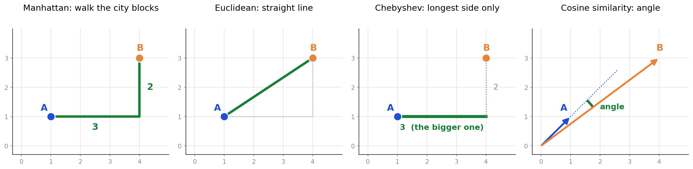

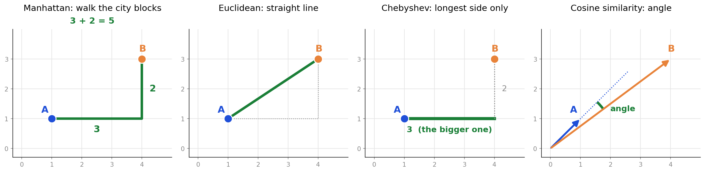{.fragment}

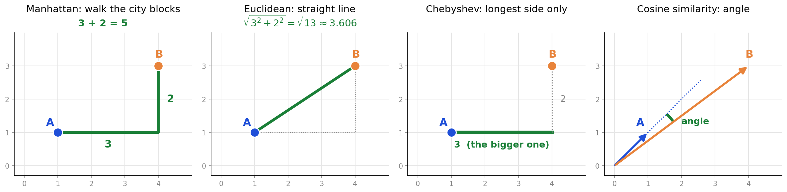{.fragment}

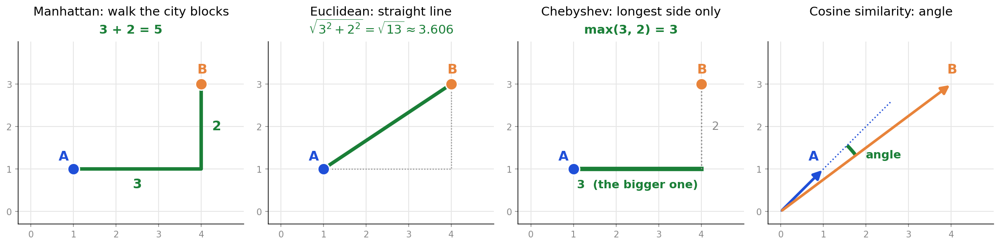{.fragment}

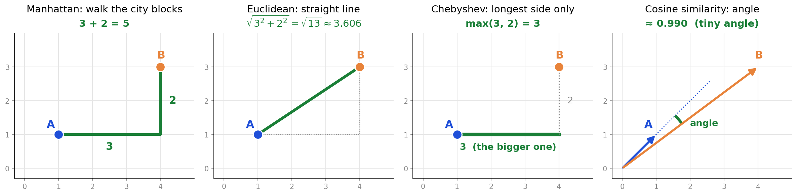{.fragment}
:::

::: {.incremental}
- **Minkowski** is a dial between them: $p = 1$ is Manhattan, $p = 2$ is Euclidean, and as $p$ grows it approaches Chebyshev. For $p = 3$: $(3^3 + 2^3)^{1/3} \approx 3.271$.
- The distances line up: Chebyshev $3 \;\le\;$ Minkowski ($p = 3$) $3.271 \;\le\;$ Euclidean $3.606 \;\le\;$ Manhattan $5$.
- **Cosine** sees A and B as very similar ($0.990$): they point in nearly the same direction, even though B is farther out.
:::

## Example: Binary Data (Hamming Distance)

Two users, 6 movies. A filled square = watched, an empty square = not watched.

```{python}
#| fig-width: 11
#| fig-height: 4.6
from matplotlib.patches import Rectangle
U = [1, 1, 0, 1, 0, 0]
V = [1, 0, 0, 1, 1, 0]
assert sum(a != b for a, b in zip(U, V)) == 2
RED = "#b5302a"
fig, axL = plt.subplots(figsize=(11, 4.6))
for col in range(6):
    differ = U[col] != V[col]
    if differ:
        axL.add_patch(Rectangle((col - 0.08, -0.08), 1.0, 2.16, fill=True, color=RED, alpha=0.12, lw=0))
        axL.add_patch(Rectangle((col - 0.08, -0.08), 1.0, 2.16, fill=False, edgecolor=RED, lw=2.5))
    for row, (vals, c) in enumerate([(V, ORANGE), (U, BLUE)]):
        axL.add_patch(Rectangle((col + 0.05, row + 0.1), 0.74, 0.8, facecolor=c if vals[col] else "white",
                                edgecolor=c, lw=2))
    axL.text(col + 0.42, 2.25, f"M{col + 1}", ha="center", fontsize=15, fontweight="bold")
    axL.text(col + 0.42, -0.45, "differ" if differ else "same", ha="center", fontsize=13,
             color=RED if differ else GREY, fontweight="bold" if differ else "normal")
axL.text(-0.2, 1.5, "User U", ha="right", va="center", fontsize=16, color=BLUE, fontweight="bold")
axL.text(-0.2, 0.5, "User V", ha="right", va="center", fontsize=16, color=ORANGE, fontweight="bold")
axL.set_xlim(-1.5, 6.1); axL.set_ylim(-0.8, 2.9); axL.axis("off")
axL.set_title("Hamming distance: count the columns that differ", fontsize=17, color=RED)
plt.tight_layout()
plt.show()
```

[**Hamming distance $= 2$**]{style="display:block; text-align:center; font-size:1.35em;"}

## Choosing the Measure in Python

```{python}
#| echo: true
from sklearn.neighbors import KNeighborsClassifier

X_docs = [[8, 2], [10, 3], [6, 1], [1, 3], [2, 5]]          # articles A to E
y_docs = ["Sports", "Sports", "Sports", "Politics", "Politics"]

for metric in ["euclidean", "manhattan", "chebyshev", "cosine"]:
    knn = KNeighborsClassifier(n_neighbors=3, metric=metric).fit(X_docs, y_docs)
    print(f"{metric:>10}: {knn.predict([[3, 1]])[0]}")
```

- Other options: `metric="minkowski", p=3`; `metric="hamming"` for binary data; `metric="correlation"`.
- Remember to **standardize** numeric variables for the $L_p$ distances. Cosine already ignores each vector's length.

## Choice of $K$: Neighborhood Size

- **Question**: Does a larger or a smaller $K$ tend to overfit?

## Choice of $K$: Neighborhood Size

- **Question**: Does a larger or a smaller $K$ tend to overfit?
- **Hint**: Which one performs better on the training data? (What is the training error of 1NN?)

## Choice of $K$: Neighborhood Size

- **Small $K$**
  - Creates many small regions for each class.
  - Leads to jagged decision boundaries and **overfitting** (1NN has zero training error).
- **Large $K$**
  - Creates fewer, larger regions.
  - Leads to smoother decision boundaries; too smooth can **underfit** ($K = n$ always predicts the overall majority class).

::: {.key}
Choose $K$ by cross-validation. For binary classification, an odd $K$ avoids tied votes.
:::

## Decision Boundaries as $K$ Grows

```{python}
#| fig-width: 16
#| fig-height: 5.6
xx, yy = np.meshgrid(np.linspace(X[:, 0].min() - 0.5, X[:, 0].max() + 0.5, 400),
                     np.linspace(X[:, 1].min() - 0.5, X[:, 1].max() + 0.5, 400))
grid = np.c_[xx.ravel(), yy.ravel()]
bg = ListedColormap(["#dfe8ff", "#FDE3C8"])

fig, axes = plt.subplots(1, 3, figsize=(16, 5.6))
for ax, k in zip(axes, [1, 15, 100]):
    m = KNeighborsClassifier(n_neighbors=k).fit(X_train, y_train)
    ax.contourf(xx, yy, m.predict(grid).reshape(xx.shape), cmap=bg, alpha=0.9)
    ax.contour(xx, yy, m.predict(grid).reshape(xx.shape), levels=[0.5], colors=INK, linewidths=1.2)
    ax.scatter(*X_train[y_train == 0].T, marker="o", facecolors="none", edgecolors=BLUE, s=30, lw=1.4)
    ax.scatter(*X_train[y_train == 1].T, marker="x", color=ORANGE, s=30, lw=1.6)
    tr = 1 - m.score(X_train, y_train)
    te = 1 - m.score(X_test, y_test)
    label = {1: "overfits", 15: "about right", 100: "underfits"}[k]
    ax.set_title(f"K = {k}  ({label})\ntrain error = {tr:.2f}, test error = {te:.2f}", fontsize=15)
    ax.set_xticks([]); ax.set_yticks([])
    ax.set_xlabel("$x_1$"); ax.set_ylabel("$x_2$")
plt.tight_layout()
plt.show()
```

- $K = 1$: training error is exactly 0, but the boundary chases noise. $K = 100$: the boundary is too smooth to follow the curved classes.

## Training vs. Test Error as $K$ Changes

```{python}
#| fig-width: 13
#| fig-height: 5.4
ks = np.arange(1, 151)
train_err, test_err = [], []
for k in ks:
    m = KNeighborsClassifier(n_neighbors=k).fit(X_train, y_train)
    train_err.append(1 - m.score(X_train, y_train))
    test_err.append(1 - m.score(X_test, y_test))
test_err = np.array(test_err)
best = ks[test_err.argmin()]

fig, ax = plt.subplots(figsize=(13, 5.4))
ax.plot(ks, train_err, color=BLUE, lw=2.2, label="training error")
ax.plot(ks, test_err, color=ORANGE, lw=2.2, label="test error")
ax.axvline(best, color=GREY, ls="--", lw=1.2)
ax.annotate(f"lowest test error at K = {best}", xy=(best, test_err.min()),
            xytext=(best * 1.6, test_err.min() + 0.08), fontsize=13,
            arrowprops=dict(arrowstyle="->", color=GREY))
ax.set_xscale("log")
ax.invert_xaxis()
ax.set_xlabel("K  (log scale)        ← smoother (underfit)          more flexible (overfit) →")
ax.set_ylabel("error rate")
ax.legend(frameon=False, loc="upper right")
plt.tight_layout()
plt.show()
```

- Training error keeps falling as $K$ shrinks (reaching 0 at $K = 1$); test error is U-shaped. Pick $K$ near the bottom of the test (or cross-validation) curve.


## KNN in SAS Enterprise Miner

- In SAS Enterprise Miner, KNN is the **Memory-Based Reasoning (MBR)** node, on the **Model** tab.
- "Memory-based" = the same idea as a lazy learner: the model *is* the stored training data.
- The MBR node measures closeness with **Euclidean distance**.
- It needs **numeric** inputs on the **same scale**, with no missing values. So in the diagram, we prepare the inputs *before* the MBR node.

::: {.key}
Same algorithm, different interface: in Python we write `KNeighborsClassifier(n_neighbors=K)`; in SAS we drag an MBR node into the diagram and set **Number of Neighbors** $= K$.
:::

## In SAS Enterprise Miner: Add Principal Components


## In SAS Enterprise Miner: Add the MBR (KNN) Node


## In SAS Enterprise Miner: Set $K$

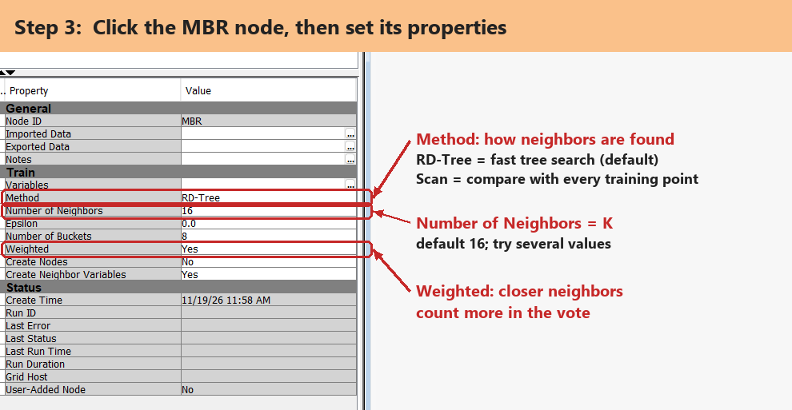

## In SAS Enterprise Miner: Run and See Results


## The Process Flow Diagram

```{python}
#| fig-width: 16
#| fig-height: 5.2
from matplotlib.patches import FancyBboxPatch
NODES = [("Data\nSource", "#eef3ff", BLUE), ("Impute", "#eef3ff", BLUE), ("Data\nPartition", "#eef3ff", BLUE),
         ("Principal\nComponents", "#eef3ff", BLUE)]
MBRS = ["MBR\nK = 5", "MBR\nK = 16", "MBR\nK = 31"]
fig, ax = plt.subplots(figsize=(16, 5.2))
W, H, GAP = 2.0, 1.2, 0.7
def node(x, y, text, fc, ec):
    ax.add_patch(FancyBboxPatch((x, y), W, H, boxstyle="round,pad=0.05,rounding_size=0.15", fc=fc, ec=ec, lw=2.2))
    ax.text(x + W / 2, y + H / 2, text, ha="center", va="center", fontsize=15, fontweight="bold", color=INK)
def link(x0, y0, x1, y1):
    ax.annotate("", xy=(x1, y1), xytext=(x0, y0), arrowprops=dict(arrowstyle="-|>", color=GREY, lw=2, mutation_scale=18))
yc = 1.6
for i, (t, fc, ec) in enumerate(NODES):
    x = i * (W + GAP)
    node(x, yc, t, fc, ec)
    if i:
        link(x - GAP, yc + H / 2, x, yc + H / 2)
xm = 4 * (W + GAP) + 0.4
for j, t in enumerate(MBRS):
    y = yc + (1 - j) * 1.6
    node(xm, y, t, "#FDE3C8", ORANGE)
    link(xm - GAP - 0.4, yc + H / 2, xm, y + H / 2)
xc = xm + W + GAP + 0.4
node(xc, yc, "Model\nComparison", "#dcf3e2", GREEN)
for j in range(3):
    y = yc + (1 - j) * 1.6
    link(xm + W, y + H / 2, xc, yc + H / 2)
ax.set_xlim(-0.2, xc + W + 0.3); ax.set_ylim(-0.1, 4.6); ax.axis("off")
plt.tight_layout()
plt.show()
```

- Each box is a node; the arrows pass the data from left to right.
- Three MBR nodes with different $K$ run side by side, and **Model Comparison** picks the best one.

## Step by Step

1. **Data Source**: create the data source and set the roles: the target variable gets role **Target**; the predictors get role **Input**; ID-type columns get role **Rejected**.
2. **Impute**: fill in missing values. KNN needs a value for every input to compute a distance.
3. **Data Partition**: split the data into training and validation (and test) sets. The default is 40% / 30% / 30%.
4. **Principal Components**: turns the inputs into new numeric variables that are on the same scale and uncorrelated. This is the input preparation SAS recommends for the MBR node, and it plays the role of **standardizing** in our KNN algorithm (Step 1).
5. **Memory-Based Reasoning**: set **Number of Neighbors** ($K$). Add more MBR nodes with other values of $K$.
6. **Model Comparison**: connect all MBR nodes; it picks the model with the best **validation** performance (for example, the lowest misclassification rate).
7. **Run** the diagram from Model Comparison, then right-click a node and choose **Results**.

## Why Principal Components Before KNN?

In SAS EM, the MBR node is **usually run after Principal Components**:

- **Same scale**: no variable dominates the distance.
- **Uncorrelated**: overlapping inputs are not counted twice.
- **Fewer dimensions**: KNN works better with fewer columns, and the search is faster.

::: {.check}
Use the **correlation** matrix; keep enough components to explain about 80–90% of the variance.
:::

## Key Settings of the MBR Node

| Property | What it means | KNN idea |
|:---|:---|:---|
| **Number of Neighbors** | how many neighbors vote (default $16$) | $K$ |
| **Method: Scan** | compares the new point with **every** training point | exactly our algorithm (Steps 2–4) |
| **Method: RD-Tree** (default) | organizes the training data in a tree to find neighbors faster | same neighbors, faster search on large data |
| Distance | always **Euclidean** | the distance function |

::: {.check}
**No cosine option?** Use what we showed earlier: cosine similarity = Euclidean distance after scaling every row to length 1. Normalize the rows first (for example, in a SAS Code node), and the MBR node's Euclidean neighbors are the cosine neighbors.
:::

## Choosing $K$ in SAS

- Copy the MBR node and change **Number of Neighbors**: for example $K = 5, 16, 31$ (odd $K$ avoids ties for a binary target).
- Connect them all to **Model Comparison**. It ranks the models on the **validation** data.
- This is the same idea as the training vs. test error plot: small $K$ overfits, large $K$ underfits, and the validation data picks the $K$ in between.

::: {.key}
The validation data in SAS plays the role of the test data (or cross-validation) in Python: never choose $K$ on the training data, where $K = 1$ always looks perfect.
:::
